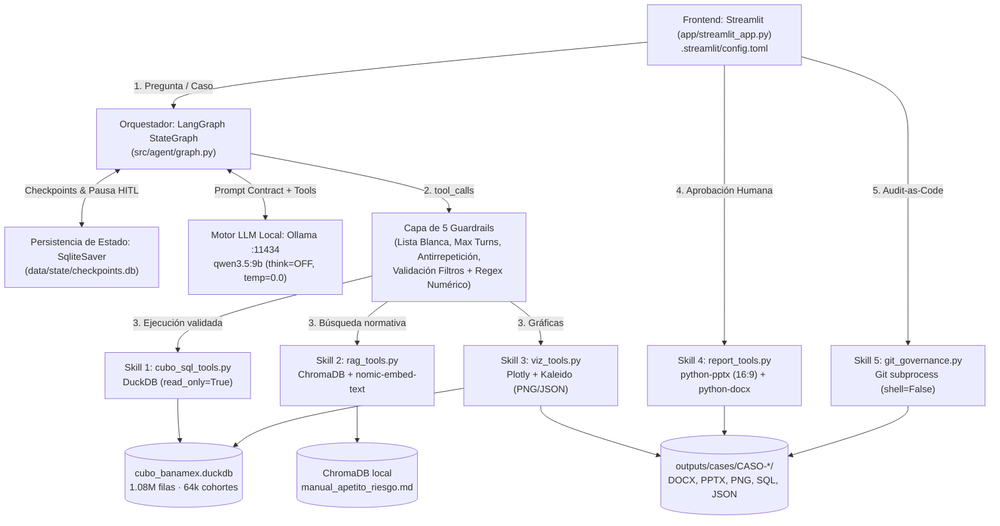
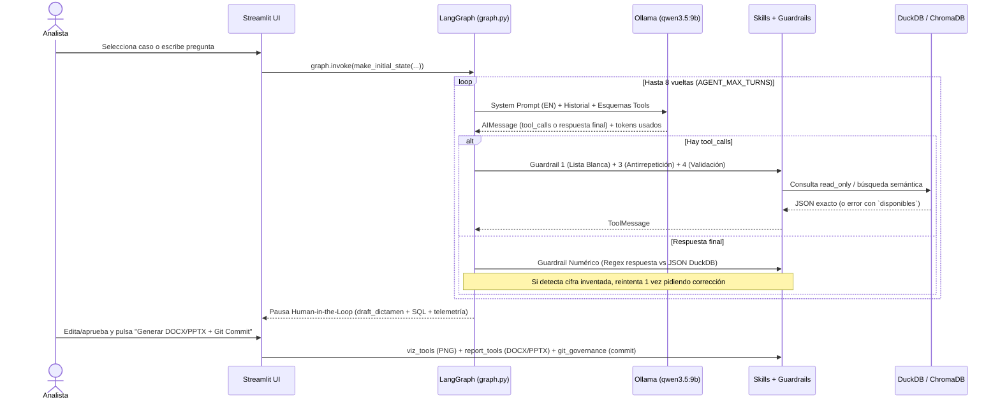

# Arquitectura y Librerías Clave — BankAgent (Banamex MVP)

Este documento explica **qué librerías sostienen el proyecto**, **por qué se eligió cada una** y **cómo se conectan entre sí** de punta a punta en ejecución 100% local.

---

## 1. Mapa General de Arquitectura

El sistema corre en **un solo equipo local** (`localhost`) o, de forma opcional, con el modelo en un **servidor con GPU de la red universitaria** (`OLLAMA_BASE_URL`), siempre sin llamadas a APIs externas de IA. La separación clave es que **el LLM razona y decide qué herramienta pedir, pero nunca toca los datos ni hace aritmética por su cuenta**: cada dato numérico viene de **DuckDB** y cada regla de negocio viene de **ChromaDB**.

---

## 2. Catálogo de Librerías Más Relevantes

### Capa 1 — Datos y Motor Analítico
| Librería | Qué hace | Dónde y cómo se conecta en `BankAgent` | Por qué se eligió |
| :--- | :--- | :--- | :--- |
| **`duckdb`** | Base de datos analítica SQL columnar embebida (en archivo local). | [`src/data/init_db.py`](../../src/data/init_db.py) ingesta `base_cards_sintetica.csv` (`1,089,833` filas) aplicando `TRIM()` y crea la tabla `cubo` + vista `v_cubo_metricas`. [`src/skills/cubo_sql_tools.py`](../../src/skills/cubo_sql_tools.py) la abre siempre con `read_only=True`. | Procesa >1M filas en milisegundos sin cargar copias en RAM (crítico en 16 GB RAM) y evita cálculos mentales del LLM. |
| **`openpyxl`** | Lectura de archivos Excel (`.xlsx`). | [`src/data/dictionary_loader.py`](../../src/data/dictionary_loader.py) extrae las 22 definiciones de `Base Cards para TEC - Diccionario de Variables.xlsx` y las convierte en Markdown. | Permite mantener el diccionario oficial del banco como fuente de verdad sin transcribirlo a mano. |
| **`pandas`** / **`pyarrow`** | Manipulación tabular ligera y soporte de intercambio de datos. | Usado solo para tablas de resumen pequeñas en [`app/streamlit_app.py`](../../app/streamlit_app.py) (`st.dataframe`). | Todo el cómputo pesado vive en DuckDB; Pandas solo formatea resultados ya agregados. |

### Capa 2 — LLM Local, Contratos y Orquestación
| Librería | Qué hace | Dónde y cómo se conecta en `BankAgent` | Por qué se eligió |
| :--- | :--- | :--- | :--- |
| **`ollama`** / **`langchain-ollama`** | Cliente y puente hacia el servidor local de Ollama (`OLLAMA_BASE_URL`, por defecto `http://localhost:11434`; puede apuntar al servidor con GPU y se valida al arrancar con `validate_ollama_base_url`). | `ChatOllama` en [`src/agent/graph.py`](../../src/agent/graph.py) invoca `qwen3.5:9b` con `temperature=0.0`, `reasoning=False` (`think: False`), `num_ctx=16384` y `.bind_tools(TOOLS)`. | 100% privado/local (cero APIs cloud), soporta *tool calling* nativo estructurado y permite apagar el modo *thinking* para evitar respuestas vacías. |
| **`langchain-core`** + **`pydantic`** | Definición de mensajes (`SystemMessage`, `HumanMessage`, `ToolMessage`), decorador `@tool` y contratos tipados (`BaseModel`). | Todas las herramientas en `src/skills/` usan `@tool(args_schema=...)` (ej. `FiltroCuboInput`, `SqlSelectInput`, `ReportInput`, `KpiCard`). | Define **contratos estrictos** entre el LLM y Python: tipos, descripciones (en inglés para ahorrar ~1.8x tokens) y validación automática. |
| **`langgraph`** + **`langgraph-checkpoint-sqlite`** | Orquestador basado en grafo de estados (`StateGraph`) con ciclos y persistencia en SQLite (`SqliteSaver`). | [`src/agent/graph.py`](../../src/agent/graph.py) conecta los nodos `agent` $\leftrightarrow$ `tools` $\rightarrow$ `guardrail` $\rightarrow$ `human_review`, guardando cada estado en `data/state/checkpoints.db`. | Reemplaza al antiguo `initialize_agent` de LangChain: da control explícito del bucle `while`, permite autocorrección de SQL, antirrepetición y pausas **Human-in-the-Loop**. |

### Capa 3 — Memoria Normativa (RAG)
| Librería | Qué hace | Dónde y cómo se conecta en `BankAgent` | Por qué se eligió |
| :--- | :--- | :--- | :--- |
| **`chromadb`** | Base de datos vectorial persistente en disco local (`data/chromadb/`). | [`src/skills/rag_tools.py`](../../src/skills/rag_tools.py), [`src/skills/interpretacion/politicas.py`](../../src/skills/interpretacion/politicas.py) y [`src/skills/interpretacion/rag_dinamico.py`](../../src/skills/interpretacion/rag_dinamico.py) usan `PersistentClient` + `nomic-embed-text` para políticas normativas y documentos adjuntos por chat (colecciones separadas). | Separa estrictamente texto normativo/documental (ChromaDB) de los números estructurados (DuckDB). Permite actualizar políticas en vivo sin reentrenar modelos. |
| **`pymupdf`** | Extracción rápida de texto e imágenes de archivos `.pdf`. | [`src/skills/interpretacion/leerpdf.py`](../../src/skills/interpretacion/leerpdf.py) e [`imagenes.py`](../../src/skills/interpretacion/imagenes.py) leen PDFs nativos y detectan páginas escaneadas para enviarlas al modelo de visión (`qwen2.5vl:7b`). | Permite analizar documentos y gráficas adjuntas en el chat o subidas como manuales de política. |
| **`scikit-learn`** + **`joblib`** | Clasificación ligera de texto (`TfidfVectorizer` + `MultinomialNB`) y persistencia de modelos. | [`src/skills/recuerdame/clasificador.py`](../../src/skills/recuerdame/clasificador.py) y [`aprendizaje.py`](../../src/skills/recuerdame/aprendizaje.py) filtran eventos útiles del chat y ajustan el estilo de respuesta (*corta*, *detallada*, *con tabla*) mediante *Gradient Bandit*. | Personaliza la concisión del copiloto según retroalimentación real sin entrenar LLMs. |

### Capa 4 — Visualización, Reportes y Gobernanza
| Librería | Qué hace | Dónde y cómo se conecta en `BankAgent` | Por qué se eligió |
| :--- | :--- | :--- | :--- |
| **`plotly`** + **`kaleido`** | Gráficas interactivas en navegador y exportación estática a PNG de alta resolución. | [`src/skills/viz_tools.py`](../../src/skills/viz_tools.py) construye las 6 gráficas financieras (`build_plotly_figure`) que Streamlit renderiza interactivamente y Kaleido exporta a `.png` para insertarlas en `.docx`/`.pptx`. | Un solo código sirve tanto para la consola interactiva como para el entregable ejecutivo impreso. |
| **`python-pptx`** + **`python-docx`** + **`xhtml2pdf`** | Generación programática de PowerPoint (`.pptx`), Word (`.docx`) y PDF (`.pdf`) desde HTML. | Fachada unificada en [`src/skills/report_tools.py`](../../src/skills/report_tools.py) (apoyada en [`src/skills/reporte/generar.py`](../../src/skills/reporte/generar.py) para reportes conversacionales editables): ambos flujos comparten `BANAMEX_PALETTE`, `templates/memo_template.docx` y generan `.docx`, `.pptx` (16:9 de 5 láminas), `.html` y `.pdf`. | Separa contenido de diseño (*Renderer Pattern* + SSOT): un solo contrato y una sola identidad visual para todos los formatos. |
| **`subprocess` (std lib)** | Invocación segura de procesos externos. | [`src/skills/git_governance.py`](../../src/skills/git_governance.py) ejecuta únicamente comandos `git` en lista blanca (`add`, `status`, `commit`, `diff`) con `shell=False`. | Implementa **Audit-as-Code**: registra el borrador de la IA en un commit y la edición aprobada por el analista en otro commit con `git diff` auditable. |

### Capa 5 — Interfaz Web y Pruebas
| Librería | Qué hace | Dónde y cómo se conecta en `BankAgent` | Por qué se eligió |
| :--- | :--- | :--- | :--- |
| **`streamlit`** | Framework web en Python para apps de analítica e IA. | [`app/streamlit_app.py`](../../app/streamlit_app.py) + [`.streamlit/config.toml`](../../.streamlit/config.toml) (tema corporativo Banamex light/dark + sidebar Navy, KPI cards, tabs, pills y chat). | Permite iterar una consola ejecutiva híbrida completa en Python puro sin mantener un frontend React/Nginx separado. |
| **`pytest`** + **`ruff`** | Pruebas automatizadas y linter/formateador PEP 8 (`line-length = 99`). | [`tests/test_db_reading.py`](../../tests/test_db_reading.py), [`tests/test_skills_and_guardrails.py`](../../tests/test_skills_and_guardrails.py) y [`tests/test_pr14_modules.py`](../../tests/test_pr14_modules.py) (27 pruebas unitarias), ejecutadas automáticamente en [`.github/workflows/ci.yml`](../../.github/workflows/ci.yml) junto a `ruff`. Complementado con [`tests/smoke_test_agent.py`](../../tests/smoke_test_agent.py). | Garantiza calidad PEP 8 y cero regresiones en cada PR; además mide el desempeño real del LLM sobre el Golden Dataset de 10 casos. |

---

## 3. Flujo Detallado de Conexión (Paso a Paso de una Solicitud)

Cuando el analista hace clic en **"Analizar con IA"** o escribe una pregunta en el **Copiloto Investigador**:

---

## 4. Fronteras y Reglas de Oro de la Arquitectura

1. **Separación estricta de motores:**
   * `DuckDB` = **100% datos tabulares numéricos** (`base_cards_sintetica.csv`), siempre en modo `read_only=True` para el agente.
   * `ChromaDB` = **100% texto normativo** (`manual_apetito_riesgo.md`). Nunca se vectorizan filas del CSV.
   * `SQLite` (`checkpoints.db`) = **100% estado de conversación y pausas** de LangGraph.
2. **Los 5 Guardrails implementados (independientes del LLM):**
   * **Lista blanca (`TOOL_MAP`):** Ninguna función fuera del diccionario registrado puede ejecutarse.
   * **Tope de vueltas (`AGENT_MAX_TURNS = 8`):** Corta cualquier bucle infinito.
   * **Antirrepetición (`seen_calls`):** Bloquea llamadas idénticas repetidas `(tool, args)` y avisa al modelo.
   * **Validación previa + Guardrail numérico:** Valida filtros contra el catálogo real devolviendo `disponibles` como datos (no crashes), bloquea DDL/DML en SQL y verifica por Regex que las cifras del texto final existan en los JSON devueltos por DuckDB.
   * **Human-in-the-Loop + Audit-as-Code:** El agente propone un borrador y se pausa; solo la acción explícita del humano en Streamlit compila `.docx`/`.pptx` y registra el commit de aprobación en Git.
3. **Sin MCP por diseño (desacoplado para el futuro):**
   * Todas las herramientas viven como funciones puras en `src/skills/`. En local corren en memoria dentro del mismo proceso (menor latencia y cero servidores extra); si mañana el equipo quiere exponerlas a Claude Desktop, Cursor u otro cliente externo vía **FastAPI** o **MCP (`FastMCP`)**, solo se envuelve `src/skills/` sin tocar la lógica del negocio ni las validaciones.
4. **Política de Sandbox y Dominio Exclusivo Financiero/Bancario:**
   * El entorno opera como un **sandbox local restrictivo**: sin salida a internet (salvo la conexión al Ollama configurado en `OLLAMA_BASE_URL`, en la red local o universitaria), sin `shell=True` ni `eval/exec`, librerías acotadas a `pyproject.toml`, y escritura únicamente en rutas en lista blanca (`data/duckdb/`, `data/politicas_internas/`, `outputs/cases/`, `src/skills/generated/`).
   * Toda interpretación (incluyendo gráficas adjuntas en chat) y generación de nuevos contratos/tools debe restringirse al **dominio financiero y bancario** tanto en el *System Prompt* como en validadores deterministas de Python.
5. **Nota sobre Evolución de Frontend (Streamlit vs. React):**
   * Para el MVP se utiliza **Streamlit 1.67** con tematización nativa (`.streamlit/config.toml`).
   * Repositorios de diseño web moderno como [`meta/astryx`](https://github.com/meta/astryx) (React 19 + StyleX) y [`GoogleChrome/modern-web-guidance`](https://github.com/GoogleChrome/modern-web-guidance) aplican únicamente si el equipo decide migrar a una arquitectura desacoplada **React + FastAPI**.

6. **Modelo local o en servidor remoto:**
   * `OLLAMA_BASE_URL` (en `.env` o variable de entorno) decide dónde corre el modelo: `http://localhost:11434` o la dirección del servidor con GPU. Se valida al arrancar (`validate_ollama_base_url` en `src/config.py`, solo `http://host[:puerto]`) y `tests/check_ollama_connection.py` verifica conectividad, modelos instalados y VRAM.
   * Solo el modelo vive en el servidor: DuckDB, ChromaDB y las tools siguen corriendo donde se ejecuta el código. Guía: [`guia_servidor_remoto.md`](../guias/guia_servidor_remoto.md). Resultados medidos: [`benchmark_servidor_remoto_issue13.md`](../contexto/benchmark_servidor_remoto_issue13.md).
---

## 5. Roadmap de Evolución del Equipo

El backlog estructurado de las **13 issues** del equipo (limpieza/FE, visión de gráficas, múltiples chats con `thread_id`, RAG dinámico, panel de configuración, dashboards dinámicos, estandarización de contratos, nuevas skills, skill generadora de contratos, anti-alucinación, dockerización en sandbox y pruebas en servidor remoto) está documentado en [`docs/planeacion/ISSUES.md`](../planeacion/ISSUES.md).
