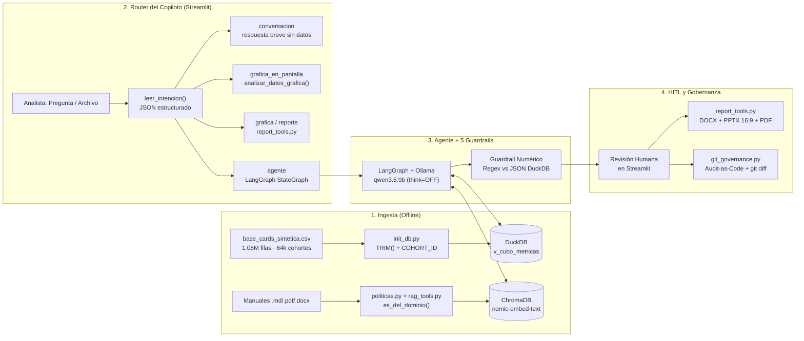
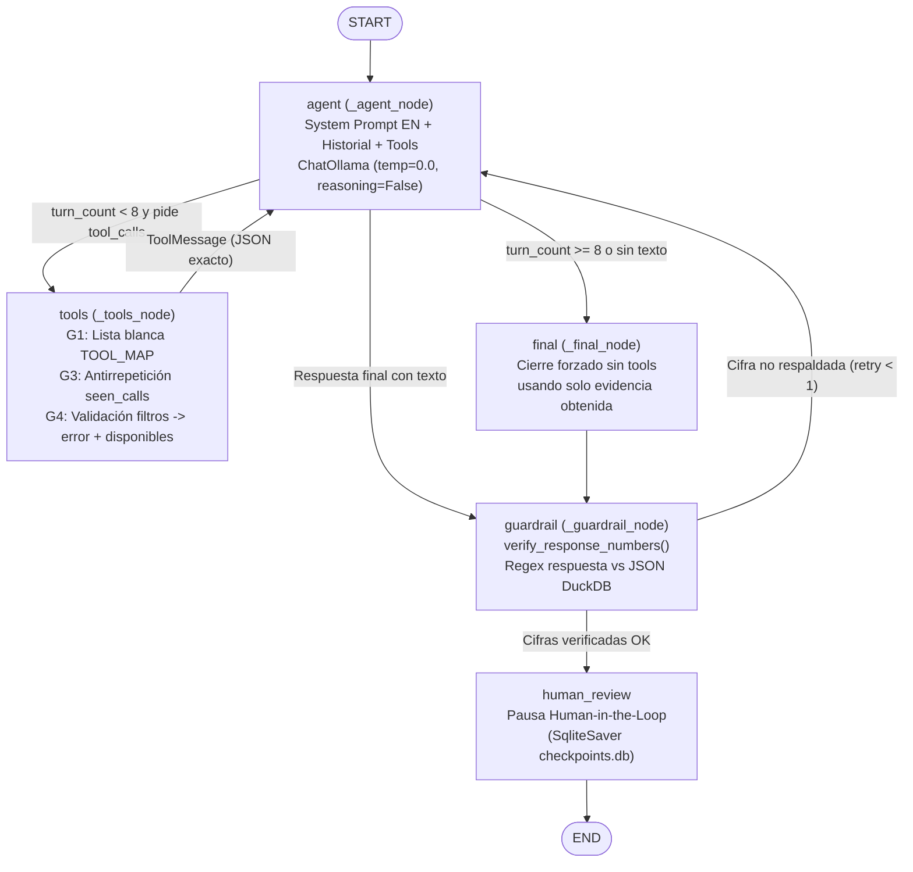

# Pipeline Técnico del Sistema y Agentes — BankAgent

Descripción detallada del flujo de datos, decisiones del Copiloto, ciclo interno del agente en **LangGraph**, guardrails deterministas y generación de entregables auditables.

---

## 1. Pipeline Macro End-to-End (De Datos Crudos a Entregable Auditado)

---

## 2. Pipeline Interno del Agente (`src/agent/graph.py`)

Cada pregunta de datos o análisis de caso entra al `StateGraph` compilado con `SqliteSaver` (`data/state/checkpoints.db`):

### Reglas de control dentro del ciclo
1. **Lista Blanca (`TOOL_MAP`):** Solo se ejecutan funciones registradas (`obtener_resumen_portafolio`, `obtener_curva_maduracion`, `ejecutar_sql_select_seguro`, `consultar_politica_riesgo`, `generar_grafica_portafolio`, `compilar_entregables_ejecutivos`).
2. **Tope de Vueltas (`AGENT_MAX_TURNS = 8`):** Si el modelo agota vueltas o termina vacío, `_final_node` fuerza una respuesta de cierre sin herramientas usando solo la evidencia ya obtenida.
3. **Antirrepetición (`seen_calls`):** Bloquea llamadas repetidas con firma `(tool, args)` idéntica y devuelve error estructurado al modelo.
4. **Validación previa + Errores como datos:** `validate_cube_filters()` valida filtros antes de consultar DuckDB (`read_only=True`) y regresa `{"error": "...", "disponibles": [...]}`; `validate_readonly_sql()` bloquea DDL/DML.
5. **Guardrail Numérico + Pausa HITL:** `verify_response_numbers()` contrasta números del texto final contra los JSON devueltos por DuckDB; si detecta una cifra fabricada solicita 1 reintento antes de pausar en `human_review`.

---

## 3. Pipeline de Interpretación, Memoria y Aprendizaje

### A. Documentos, Imágenes y Filtro de Dominio (`src/skills/interpretacion/`)
1. Al subir un archivo en el chat o en *Políticas*, `leer_documento()` despacha según extensión: `.pdf` (`pymupdf` + `qwen2.5vl:7b` si hay páginas escaneadas `<30` chars), `.docx` (`python-docx`) o imagen (`.png`/`.jpg` vía `qwen2.5vl:7b`).
2. `dominio.es_del_dominio()` verifica relevancia bancaria (primero por puntaje determinista con el catálogo del cubo y, si hay duda, clasificación binaria con Ollama). Archivos ajenos a banca se rechazan antes de indexarse.
3. Los manuales normativos se indexan en ChromaDB (`politicas_riesgo_banamex`); los adjuntos temporales de un chat van a una colección aislada (`documentos_chats` vía `rag_dinamico.py`).

### B. Memoria Aislada y Estilo Adaptativo (`src/skills/recuerdame/`)
1. **Aislamiento de chats (`chats.py`):** Cada conversación se guarda en `chats_pasados/chat_*.json`. Al superar `3,000` caracteres sin resumir, `comprimir_chat()` condensa el historial antiguo en 5 campos fijos conservando intactos los últimos 4 mensajes.
2. **Gradient Bandit (`clasificador.py` + `aprendizaje.py`):**
   * `elegir_accion()` escoge el estilo (`corta`, `detallada`, `con_tabla`) con `softmax` sobre preferencias `H`.
   * `registrar_evento()` y `dar_recompensa()` asignan recompensas automáticas (`-1` si falla o repite pregunta, `-0.5` si avisa guardrail, `+1` si el usuario aprueba o descarga un entregable).
   * Cada 6 preguntas, `limpieza()` filtra eventos con `TfidfVectorizer + MultinomialNB` y actualiza `politica.json`.

---

## 4. Pipeline de Entregables Unificados y Gobernanza (`report_tools.py` + `git_governance.py`)

1. Tanto el flujo de **Dictamen HITL** (`compilar_entregables_ejecutivos`) como el flujo de **Reportes desde Chat** (`generar_reporte_chat` / `editar_reporte_chat`) convergen en la fachada `src/skills/report_tools.py`.
2. Ambos comparten `BANAMEX_PALETTE` (`src/config.py`) y `templates/memo_template.docx`, produciendo **`.docx`**, **`.pptx` (16:9 de 5 diapositivas)**, **`.html`** y **`.pdf`**.
3. En casos de comité, `git_governance.py` guarda `queries.sql`, `evidence.json` y `draft_dictamen.md` en `outputs/cases/{case_id}/` y registra commits auditables (`shell=False`) con `git diff` entre el borrador de la IA y la versión aprobada por el analista.
